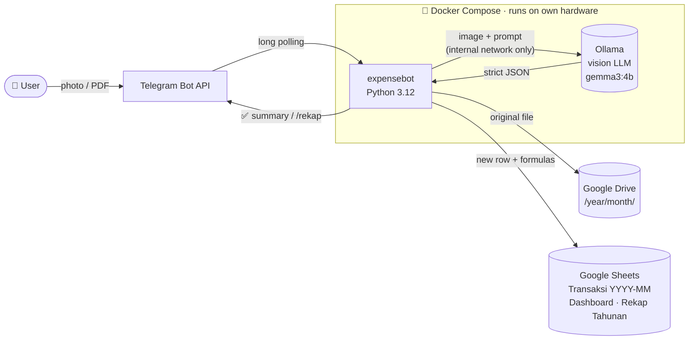

# 🧾 ExpenseBot: Receipt-to-Spreadsheet Automation with a Local Vision LLM

> Send a photo of a receipt to Telegram, and it shows up a few seconds later as a categorized row in Google Sheets, with the original file archived in Google Drive and dashboards updated. No typing, no cloud AI bills, and the receipt images never leave your own machine for inference.


-000000)


🇮🇩 *Dokumentasi Bahasa Indonesia: [README.id.md](README.id.md)*

---

## The problem

Manual expense tracking fails for one reason: **friction**. Typing every coffee, parking ticket and e-wallet top-up into a spreadsheet works for about a week. Commercial apps solve the friction but send your financial documents to third-party clouds.

## The solution

ExpenseBot turns a **chat message into a structured financial record**:

| Step | What happens | Tech |
|---|---|---|
| 1. Capture | User sends a receipt photo or PDF (bank transfer slip, invoice, payslip) to a private Telegram bot | `python-telegram-bot` |
| 2. Normalize | Image is resized; each PDF page is rendered to PNG | Pillow, PyMuPDF |
| 3. Extract | A **local vision LLM** reads the receipt and returns strict JSON: date, merchant, type (income/expense), category, line items, total | Ollama · `gemma3:4b` · OpenAI-compatible API |
| 4. Validate | JSON is validated against a Pydantic schema; category is forced to match the income/expense taxonomy; one self-correcting retry on bad output | Pydantic v2 |
| 5. Deduplicate | SHA-256 hash of the file blocks the same receipt being recorded twice | `hashlib` |
| 6. Archive | Original file is uploaded to Drive under `/<year>/<month>/` | Google Drive API v3 |
| 7. Record | Row appended to a per-month tab `Transaksi YYYY-MM`; dashboard and yearly recap refresh | Google Sheets API (`gspread`) |
| 8. Report | `/rekap harian · mingguan · bulanan · tahunan` returns summaries in chat | Pure-Python aggregation |



## Demo

<!-- Tip: add real screenshots here — they matter most for a portfolio.
     Suggested files: docs/assets/telegram-chat.png, docs/assets/dashboard.png, docs/assets/rekap-tahunan.png
     Blur merchant names / amounts you don't want public. -->

**Telegram interaction**

```text
You:  [photo of a minimarket receipt]
Bot:  ⏳ Membaca struk... 40%
Bot:  🧾 Konfirmasi Pengeluaran
      Tanggal: 03 Sep 2026
      Merchant: Indomaret
      Kategori: Makan & Minum
      Total: Rp98.800

      Item:
        • Air Mineral 1.5L — Rp7.500
        • Roti Tawar — Rp18.900
        • ...

      ✅ Tersimpan otomatis.

You:  /rekap bulanan agustus
Bot:  📊 Rekap Keuangan — Agustus 2026
      Pemasukan: Rp…
      Pengeluaran: Rp…
      Saldo: Rp…
      (42 transaksi)

      Pengeluaran per kategori:
        • Makan & Minum: Rp…
        • Transportasi: Rp…
```

**Google Sheets output:** monthly transaction tabs, a **Dashboard** with a month picker (`B1 = yyyy-mm`), category pie charts and an income-vs-expense chart, plus a **Rekap Tahunan** (yearly recap) tab with a monthly trend chart.

## Key features

- 📧 **V2, hands-free from Gmail:** mobile-banking notification emails (BSI BYOND, blu by BCA Digital) are read automatically, saved to the sheet, and reported to Telegram as they arrive. There is nothing to upload
- 📸 **Multi-format input:** camera photos, scanned PDFs (multi-page), mobile-banking and e-wallet transfer receipts
- 🧠 **Local, private AI:** inference runs on your own GPU or CPU through Ollama. No OpenAI or Gemini API keys and no per-request cost
- 💸 **Income vs. expense detection:** for bank transfers, the configured account-holder name tells the bot which way the money moved (`Rekening Sumber` vs `Nama Penerima`)
- 🗂️ **14 expense and 5 income categories:** based on a household budgeting taxonomy (see [`kategorisasi_pengeluaran_bulanan.md`](kategorisasi_pengeluaran_bulanan.md))
- 🔢 **Rupiah-aware number parsing:** the prompt makes the model treat `.` as a thousands separator, so `Rp4.500.000` is read as 4,500,000 and not 4.5
- ♻️ **Duplicate protection:** content-hash dedupe key stored per row
- 📅 **Self-maintaining spreadsheet:** a new month tab is created on the first transaction of a month, the old flat layout is migrated automatically, and dashboard formulas and charts are rebuilt idempotently
- 📊 **Chat-based reporting:** daily, weekly, monthly (any month by name or `yyyy-mm`) and yearly recaps
- 🛡️ **Hardened by default:** user-ID allowlist, spreadsheet formula-injection escaping, non-root container, no inbound ports, bot token kept out of logs

## Tech stack

| Layer | Choice | Why |
|---|---|---|
| Interface | Telegram Bot (polling) | Zero-UI cost, works on any phone, no public endpoint or webhook needed |
| AI | Ollama + `gemma3:4b` (vision) | Small enough for a laptop GPU, multimodal, OpenAI-compatible API so it can be swapped for any provider |
| Validation | Pydantic v2 / pydantic-settings | Typed contract between an unreliable LLM and the database |
| Docs processing | PyMuPDF, Pillow | Fast PDF rasterization; images capped at 1600 px to keep inference quick |
| Storage | Google Sheets + Drive | Familiar to non-technical users; free; built-in charts |
| Runtime | Docker Compose (2 services) | One command to run; `restart: unless-stopped` keeps it running around the clock |
| Quality | pytest (73 tests), pytest-asyncio, respx, ruff | Network and LLM are mocked; pure logic is unit-tested |

## Quick start

```bash
# 1. Configure
cp .env.example .env            # fill Telegram token, allowed user IDs, Sheet & Drive IDs

# 2. Authorize Google once (on the host, opens a browser)
python -m venv .venv && source .venv/bin/activate   # Windows: .venv\Scripts\activate
pip install -r requirements-dev.txt
python scripts/authorize_google.py                  # creates credentials/authorized_user.json

# 3. Run bot + LLM
docker compose up -d --build
docker exec -it ollama ollama pull gemma3:4b        # once; model persists in a volume
docker compose logs -f expensebot
```

Full step-by-step setup (BotFather, Google Cloud OAuth, Sheet/Drive IDs, GPU, running 24/7): **[docs/setup-and-deployment.md](docs/setup-and-deployment.md)**

### V2: automatic recording from Gmail

1. In Google Cloud Console, **enable the Gmail API** for the same project (APIs & Services → Library → Gmail API → Enable). On the OAuth consent screen, add the scope `.../auth/gmail.readonly`.
2. Re-run `python scripts/authorize_google.py` on the host and approve the new Gmail permission. The bot only asks for **read-only** Gmail access: it never sends, labels or deletes mail.
3. Set `ACCOUNT_HOLDER_NAME` in `.env`. It lets the bot recognise transfers between your own accounts (e.g. BSI → blu), which are reported but not recorded so totals aren't counted twice.
4. Run `docker compose up -d --build`, then preview the parsing without writing anything:
   `docker compose exec expensebot python scripts/gmail_dry_run.py --limit 10`

The bot polls Gmail every `GMAIL_POLL_INTERVAL_SECONDS` (default 60 s) using `GMAIL_QUERY`. Each new transaction:
- is saved to the month's tab, with Sumber = `Email BSI`/`Email blu` and a link back to the email
- triggers a Telegram message: 💸 Uang Keluar / 💰 Uang Masuk, with the amount, counterparty and category

Amounts, dates and counterparties are parsed **deterministically** from the bank templates, and the local LLM only picks the category. Senders without a parser fall back to full LLM extraction. Already-handled email IDs are remembered in the `expensebot_data` volume, and the sheet's dedupe key guards against double rows.

## Documentation

| Doc | Contents |
|---|---|
| [Architecture](docs/architecture.md) | Components, module map, runtime topology, data model |
| [Workflow](docs/workflow.md) | End-to-end receipt lifecycle (sequence diagram), error paths, `/rekap` flow |
| [LLM extraction design](docs/llm-extraction.md) | Prompt engineering, JSON schema, validation and retry, known failure modes |
| [Google Sheets design](docs/google-sheets-design.md) | Tab layout, columns, dashboard formulas, charts, migration |
| [Setup & deployment](docs/setup-and-deployment.md) | Installation, configuration reference, running 24/7, GPU, corporate proxy CA |
| [Engineering decisions](docs/engineering-decisions.md) | Trade-offs, security model, testing strategy, limitations, roadmap |

## Project structure

```
src/expensebot/
├── main.py                 # Composition root: config → clients → handlers → polling (with startup retry)
├── config.py               # Typed settings from .env (pydantic-settings)
├── models.py               # ExpenseRecord / ExpenseItem + category taxonomy
├── telegram/
│   ├── handlers.py         # Photo/PDF ingestion pipeline, /start, /rekap, global error handler
│   ├── gmail_job.py        # V2: background Gmail polling loop → Telegram reports
│   └── formatting.py       # Indonesian-language message formatting, Rupiah formatting
├── gmail/                  # V2: bank notification emails → sheet rows
│   ├── client.py           # Read-only Gmail API access (list/get, MIME decoding)
│   ├── html_text.py        # Email HTML → label/value text lines
│   ├── parsers.py          # Deterministic BSI BYOND + blu parsers (amount, date, counterparty)
│   ├── ingest.py           # Poll → parse → categorize → dedupe → append
│   └── state.py            # Processed-email-ID store (JSON on a Docker volume)
├── llm/
│   ├── client.py           # Ollama client (OpenAI SDK), parse + one self-correcting retry
│   ├── prompts.py          # System prompt (extraction rules, Rupiah normalization)
│   └── schema.py           # Pydantic validation of raw LLM JSON
├── documents/converter.py  # Photo/PDF → normalized PNG pages
├── google/
│   ├── auth.py             # OAuth user credentials + refresh
│   ├── sheets.py           # Monthly tabs, Dashboard, Rekap Tahunan, charts, dedupe, migration
│   └── drive.py            # Receipt upload to /<year>/<month>/ folders
├── recap.py                # Pure aggregation logic (no I/O, easy to test)
└── timeutil.py             # WIB (Asia/Jakarta) clock helpers
scripts/                    # One-off: Google OAuth login, manual sheet (re)initialization
tests/                      # 73 unit tests across 11 modules
```

## How it was built

I designed and built this project through iterative, AI-assisted development with **Claude Code**. I set the requirements, made the architecture and product decisions and tested against real receipts. Claude Code did much of the implementation, refactoring and test writing, and each iteration was checked against real usage (for example, the Rupiah thousands-separator rule and the bank-transfer direction rule were both added after real misreads). The workflow is described in [docs/engineering-decisions.md](docs/engineering-decisions.md#development-workflow).

## Roadmap

- [ ] Cloud or always-on hosting (small VPS or home server) so the bot doesn't depend on a laptop being awake
- [ ] Optional confirm/edit step via inline keyboard before saving
- [ ] Duplicate check across the full history (currently the current and previous month)
- [ ] Multi-receipt PDFs (one PDF containing several receipts)
- [ ] Accuracy benchmark on a labelled receipt set (field-level precision per model)
- [ ] Budget targets per category with over-budget alerts

## Author

**Alfredo Abdul Aziz**, Subdirectorate of Data Science, Statistics Indonesia (BPS) · B.A.Sc. Statistics, Politeknik Statistika STIS

<!-- Add your GitHub / LinkedIn links here -->
