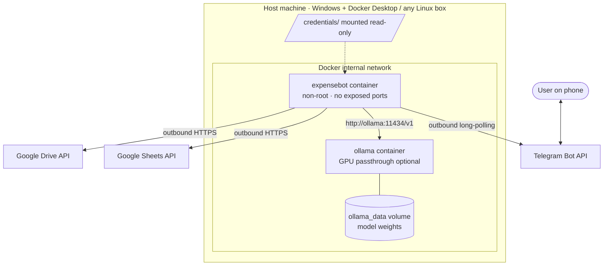
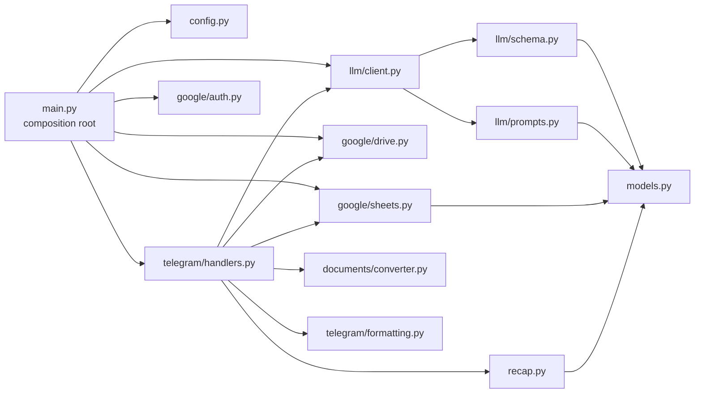
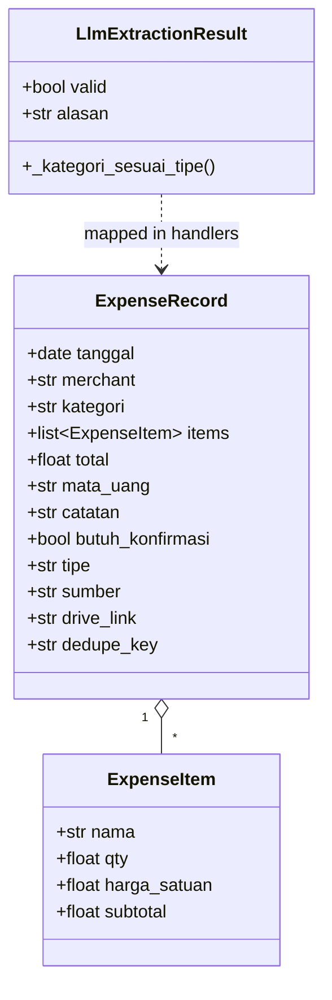

# Architecture

## System context

**All connections start from the bot (outbound only).** Telegram is reached by long polling instead of a webhook, so the host never needs a public IP, an open port or a TLS certificate. Ollama is only reachable on the internal Docker network.

## Module map

| Module | Responsibility | I/O? |
|---|---|---|
| `main.py` | Loads settings, builds clients with **exponential-backoff startup retry**, registers handlers, starts polling | ✅ |
| `config.py` | `pydantic-settings` model of every environment variable | – |
| `telegram/handlers.py` | The ingestion pipeline, `/start`, `/rekap`, global error handler | ✅ |
| `telegram/formatting.py` | All user-facing Indonesian text and Rupiah formatting | – |
| `llm/client.py` | Calls Ollama via the OpenAI SDK, strips code fences, validates, retries once | ✅ |
| `llm/prompts.py` | System prompt builder (injects category lists and the account-holder rule) | – |
| `llm/schema.py` | `LlmExtractionResult`, the contract for raw model output | – |
| `documents/converter.py` | Photo → RGB PNG ≤1600 px; PDF → one PNG per page at 2× zoom | – |
| `google/auth.py` | Loads and refreshes OAuth user credentials; best-effort token persistence | ✅ |
| `google/sheets.py` | Spreadsheet structure, append, dedupe lookup, reads, dashboard and charts | ✅ |
| `google/drive.py` | Year/month folder tree (cached) and file upload | ✅ |
| `recap.py` | **Pure** aggregation (daily, weekly, monthly, yearly) | – |
| `timeutil.py` | WIB clock, because containers default to UTC | – |

Business logic that needs no I/O (`recap.py`, `formatting.py`, `schema.py`, `converter.py`) is kept separate from code that talks to Google or Telegram. That separation is what makes 73 fast unit tests possible.

### Dependency injection

`main.py` builds every client once and stores them in `application.bot_data`. Handlers read `llm_client`, `sheets_repo`, `drive_repo` and `allowed_user_ids` from there, so tests can drop in mocks without patching imports.

### Concurrency

`python-telegram-bot` is asyncio-based, while the Google and OpenAI SDK calls block. Each blocking call is wrapped in `asyncio.to_thread(...)`, so a slow LLM call (often 10–60 s on CPU) never freezes the event loop. A separate asyncio task animates a progress message (`⏳ Membaca struk... 40%`) while waiting.

## Data model

- `tipe` is `Literal["Pengeluaran", "Pemasukan"]`; `sumber` is `Foto` or `PDF`; `dedupe_key` is `sha256(file)[:16]`; `tanggal`, `catatan`, `drive_link` are optional.
- `LlmExtractionResult` carries the same extraction fields plus `valid`/`alasan`.

`LlmExtractionResult` is the **untrusted** boundary object: every field has a safe default, and a validator forces `kategori` into the list that matches `tipe`. `ExpenseRecord` is the **trusted** domain object that gets persisted.

### Category taxonomy

- **Expense (14):** Kebutuhan Pokok · Makan & Minum · Transportasi · Kesehatan & Kebersihan Diri · Rumah Tangga · Anak & Keluarga · Pendidikan & Pengembangan Diri · Hiburan & Gaya Hidup · Sosial & Kewajiban · Pakaian & Penampilan · Tabungan & Investasi · Pajak & Administrasi · E-commerce · Lain-lain / Tak Terduga
- **Income (5):** Gaji · Freelance/Bonus · Hasil Investasi · Transfer Masuk · Pemasukan Lainnya

Derived from [`kategorisasi_pengeluaran_bulanan.md`](../kategorisasi_pengeluaran_bulanan.md) (a household budgeting framework compatible with the 50/30/20 rule), with `E-commerce` added for e-wallet and marketplace top-ups.
