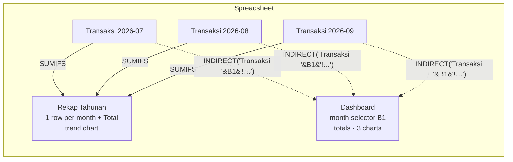

# Google Sheets design

The spreadsheet acts as the database, the reporting layer and the user-facing UI all at once. The bot **creates and repairs the structure itself** on every start (`SheetsRepository.ensure_structure()`), so it can be pointed at an empty spreadsheet.

## Tab layout



### `Transaksi YYYY-MM` (one tab per month)

| Col | Header | Example | Notes |
|---|---|---|---|
| A | Tanggal | `2026-09-03` | ISO date from the receipt (blank if unreadable) |
| B | Waktu | `14:22` | WIB time it was recorded |
| C | Kategori | `Makan & Minum` | Dashboard formulas use this column |
| D | Merchant | `Indomaret` | formula-injection escaped |
| E | Item | `Roti Tawar x1, Air Mineral x2` | compact item summary |
| F | Total (Rp) | `98800` | Dashboard formulas use this column |
| G | Sumber | `Foto` / `PDF` | |
| H | Link Drive | `https://drive.google.com/…` | original receipt |
| I | Catatan | | |
| J | Tipe | `Pengeluaran` / `Pemasukan` | added later, so it sits at the end |
| K | Dedupe Key | `a3f9…` | `sha256(file)[:16]` |

> **Why does `Tipe` come after `Catatan`?** It was added after income tracking was introduced. Putting it at the end means the columns every formula depends on (C and F) never move, so existing spreadsheets keep working without changes. Blank `Tipe` values are treated as `Pengeluaran` everywhere for the same reason.

New month tabs are created **lazily** when the first transaction of that month comes in, so the bot doesn't need a restart or a scheduled job at the turn of the month.

### `Dashboard`

- **B1 month selector** (`yyyy-mm`, defaults to the current month). Every formula reads from the chosen month's tab through `INDIRECT`, so one dashboard can show any month.
- Totals: `=IFERROR(SUMIFS(INDIRECT(...F:F), INDIRECT(...J:J), "Pengeluaran") + SUMIFS(... ""), 0)`. `IFERROR` turns a mistyped month into 0 instead of a chain of `#REF!` errors.
- Per-category breakdowns use `QUERY(... "select C, sum(F) where J='Pengeluaran' group by C")`, which spills one row per category. Rows are reserved for the **full** category list so a spill never overwrites the next section.
- Charts (created through the Sheets API `batchUpdate`): expense-by-category pie, income-by-category pie, and an income-vs-expense column chart.

### `Rekap Tahunan`

One row per existing month tab with `Pemasukan`, `Pengeluaran` and `Saldo` (all `SUMIFS` formulas, so manual edits in a month tab show up automatically), a `Total` row, and a monthly column chart of income vs expense. It is rebuilt whenever a new month tab appears. `/rekap tahunan` reads these already-calculated rows instead of re-adding every tab in Python.

## Problems found and fixed

These are worth knowing for anyone automating Google Sheets:

| Problem | Symptom | Fix |
|---|---|---|
| **Locale separators**: `id_ID` and many other locales expect `;` between formula arguments | Every formula shows `#ERROR!` | Set the spreadsheet locale to `en_US` through the API on startup |
| **Auto-parsing**: `"2026-09"` typed with `USER_ENTERED` is stored as a *date serial number* | `INDIRECT` string concatenation silently breaks | Write the selector cell with `raw=True` |
| **gspread 6 changed `update()` argument order** | Values written to the wrong place | Use `update(values, range_name)` everywhere |
| **Leftover cells** from an older layout | Ghost values or a `#REF!` "would overwrite data" error on a spill | `worksheet.clear()` before rebuilding the dashboard |
| **Formula injection**: OCR text that starts with `= + - @` | A merchant name could run as a formula | `escape_formula_injection()` adds a leading `'` |

## Migration

Earlier versions used a single flat `Transaksi` tab. On startup, `_migrate_legacy_transaksi()` splits its rows into monthly tabs by their own `Tanggal` (undated rows go to the current month) and then deletes the old tab. This runs once and does nothing after that.

## Drive layout

```
<GOOGLE_DRIVE_FOLDER_ID>/
└── 2026/
    ├── 08/  receipt files…
    └── 09/  receipt files…
```

Folder IDs are cached in memory after the first lookup or creation.
