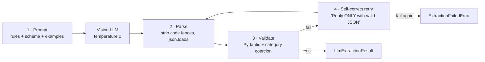

# LLM extraction design

The core of the project is turning an **unreliable, free-form model** into a **reliable data source**. That is done in four layers.

## 1. Prompt engineering (`llm/prompts.py`)

The system prompt (in Indonesian, to match the receipts) gives the model a role (*personal finance bookkeeping assistant*) and numbered rules. Each one targets a failure seen during testing:

| Rule | Failure it prevents |
|---|---|
| Decide `tipe` (expense vs income) **before** the category | Payslips and incoming transfers being logged as spending |
| Category **must** come from the list for that `tipe` | Made-up categories, and income rows showing up in expense charts |
| Top-ups and transfers to Shopee / ShopeePay / GoPay / Tokopedia → `E-commerce` | Guessing what the balance will be spent on later |
| Missing date → `null` + `butuh_konfirmasi: true` | Made-up dates |
| **Rupiah normalization**: `.` is a thousands separator, strip everything except digits, with worked examples (`Rp4.500.000 → 4500000, NOT 4500`) | The most damaging error: amounts cut by ×1000 |
| Transfer receipts: use `Nominal Transfer` / `Total`, not `Biaya Admin` | Recording the fee instead of the amount |
| Not a receipt → `{"valid": false, "alasan": "..."}` | Junk rows from selfies or screenshots |
| Account-holder rule (optional, from `ACCOUNT_HOLDER_NAME`): own name in *Rekening Sumber* means expense; own name in *Nama Penerima* means income | Bank-transfer slips look the same in both directions |

The output schema is written into the prompt, and `temperature=0` makes the output as deterministic as possible.

## 2–3. Parsing and validation (`llm/schema.py`)

- Markdown code fences are stripped (small models often add them anyway).
- `LlmExtractionResult` gives **every field a safe default**, so a partial answer still parses.
- `@model_validator` `_kategori_sesuai_tipe` **coerces** a category that doesn't match its `tipe` to `Lain-lain / Tak Terduga` or `Pemasukan Lainnya` instead of rejecting the row. A slightly wrong category is better than a lost receipt, and an expense category on an income row would break the dashboard filters.

## 4. Self-correcting retry (`llm/client.py`)

If parsing or validation fails, the model's own bad output is appended to the conversation, followed by *"Reply ONLY with valid JSON according to the schema, no other text."* The retry happens **once**. A second failure raises `ExtractionFailedError`, and the user is asked to retake the photo.

Connection or timeout errors (`openai.APIError`, 120 s timeout) are a **different** exception (`LLMUnavailableError`), so the user is told *what* is wrong: an unreadable photo or a stopped server.

## Model choice

`gemma3:4b` is the default: multimodal, small enough to run on a consumer GPU or even CPU, and good at reading printed Indonesian receipts. Because the client uses the **OpenAI-compatible API**, switching models is a one-line `.env` change (`LLM_MODEL`). Switching to a hosted provider only needs `LLM_BASE_URL` and `LLM_API_KEY`.

## Image preprocessing (`documents/converter.py`)

- Photos: converted to RGB, longest side capped at **1600 px** (enough to read small receipt text while keeping vision-token cost and latency down), re-encoded as PNG.
- PDFs: every page rendered at **2× zoom** with PyMuPDF and given the same cap. All pages go into **one** request, so a long receipt split across pages becomes one transaction.

## Known limitations

- Handwritten or heavily crumpled receipts are still error-prone with a 4B model.
- There is no field-level confidence score. `butuh_konfirmasi` is the only uncertainty signal.
- One message = one transaction.

A labelled benchmark set (field-level accuracy per model) is on the roadmap.
