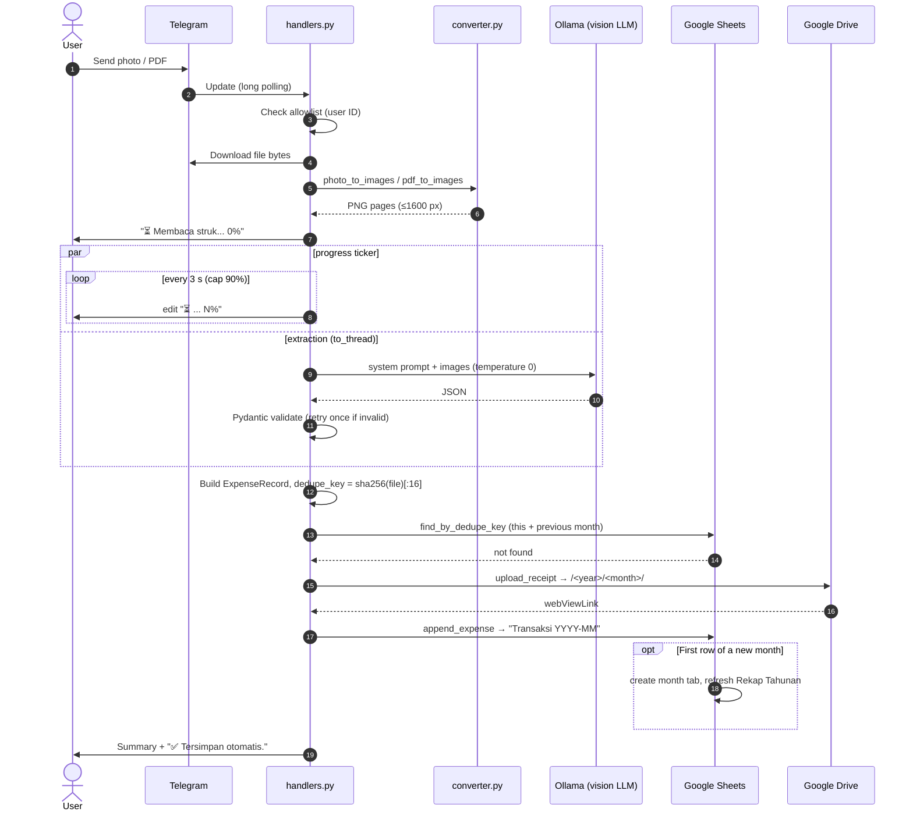
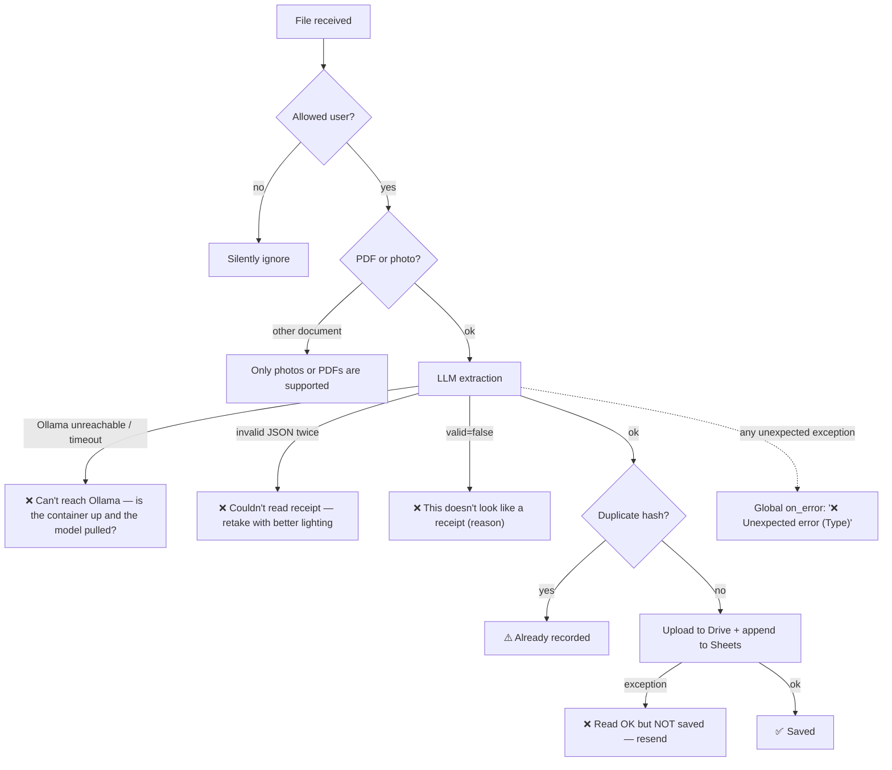

# Workflow: from receipt to spreadsheet

## Happy path

### Design notes

- **No confirmation step (by design).** Once a receipt is read correctly, it is saved straight away, which keeps the interaction to *one* message. If something is misread, it is fixed in the sheet itself. Fields the model couldn't read (for example a missing date) set `butuh_konfirmasi` and add a ⚠️ hint to the reply.
- **Drive first, then Sheets.** The Drive link is part of the row, so the upload must finish first. If either step fails, the user is told the receipt **was not recorded**, so nothing is ever half-saved without the user knowing.
- **Transaction date picks the tab.** A receipt from 31 August sent on 2 September goes into `Transaksi 2026-08`. If no date was found, the current WIB date is used.

## Error paths

Every failure ends with a clear message in Indonesian. Nothing fails silently: a global `on_error` handler catches anything the pipeline didn't expect.

## Startup sequence

1. Load `.env` into typed `Settings`.
2. Load and refresh Google OAuth credentials, **retried 4× with exponential backoff (2 → 4 → 8 s)**. After a Windows or Docker restart, containers often start before DNS is ready. A missing credentials file is *not* retried, because waiting won't fix it.
3. Connect to Sheets and run `ensure_structure()`: set the locale, migrate the old layout, create the current month tab, the yearly recap and the dashboard. Also retried.
4. Connect to Drive (retried).
5. Ping Ollama. If it is down, the bot **logs a warning and keeps running**: recap commands still work, and extraction recovers once Ollama is up.
6. Register handlers and start polling.

## `/rekap` command

| Command | Data source | Window |
|---|---|---|
| `/rekap` or `/rekap harian` | current + previous month tabs | today |
| `/rekap mingguan` | current + previous month tabs | Monday → today (correct across month boundaries) |
| `/rekap bulanan` | current month tab | 1st → today |
| `/rekap bulanan agustus` / `2026-08` | that month's tab | whole month |
| `/rekap tahunan [2026]` | `Rekap Tahunan` tab (already aggregated by Sheets) | Jan → Dec |

A bare month name that would fall in the future is read as last year's month (asking for `januari` in March means *this* January).
